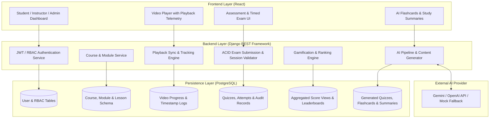

# Cognify LMS 🎓🧠

> An intelligent, AI-augmented Learning Management System engineered for seamless course management, granular video analytics, automated knowledge assessments, and personalized study pipelines.

[](https://www.djangoproject.com/)
[](https://www.django-rest-framework.org/)
[](https://reactjs.org/)
[](https://www.postgresql.org/)
[](https://ai.google.dev/)
[](LICENSE)

---

## 📌 Table of Contents

- [Overview](#-overview)
- [System Architecture](#-system-architecture)
- [Key Features](#-key-features)
- [Tech Stack](#-tech-stack)
- [Team Task & Domain Allocation](#-team-task--domain-allocation)
- [Database & Architectural Strategy](#-database--architectural-strategy)
- [Getting Started](#-getting-started)
  - [Prerequisites](#prerequisites)
  - [Backend Setup](#backend-setup)
  - [Frontend Setup](#frontend-setup)
  - [Environment Configuration](#environment-configuration)
- [Contributing](#-contributing)
- [Security](#-security)
- [License](#-license)

---

## 📖 Overview

**Cognify LMS** is a full-stack Learning Management System designed to bridge modern course delivery with generative artificial intelligence. Built with **React** on the frontend, **Django REST Framework** on the backend, and **PostgreSQL** as the core relational data store, Cognify LMS provides robust capabilities for course delivery, video progress analytics, timed assessments, and credential verification.

An integrated **AI intelligence layer** digests lecture transcripts and syllabus reading materials to autonomously generate contextual multiple-choice quizzes, flashcard decks, and personalized study summaries tailored to each student's performance and knowledge gaps.

---

## 🏗 System Architecture

Cognify LMS operates as a decoupled client-server architecture with high-performance relational persistence and an asynchronous LLM processing pipeline:



---

## ✨ Key Features

### 1. Role-Based Access Control (RBAC) & Course Hierarchy
- Granular permissions for **Students**, **Instructors**, and **Platform Administrators**.
- Multi-tier curriculum structure: `Courses` ➔ `Modules` ➔ `Lessons` (supporting video, markdown, and resource attachments).
- Enrollment validations, prerequisite constraints, and audit logging.

### 2. Video Telemetry & Playback Tracking
- Real-time tracking of student video playback positions with intelligent debounced API synchronization.
- Persistent playback resumption across sessions directly saved in PostgreSQL.
- Watch-time metrics, drop-off analytics, and completion milestone detection.

### 3. Assessment Engine & ACID Timed Exam Manager
- Multiple question types: Single-select, Multi-select, True/False, and Short answer.
- Strict server-side duration enforcement with deterministic start/end timestamp validation in PostgreSQL.
- ACID transaction handling ensures idempotent, tamper-proof submission grading and attempt records.

### 4. Dynamic Leaderboards & Tamper-Evident Certification
- Real-time course and platform leaderboards computed via PostgreSQL Window Functions (`DENSE_RANK()`, `RANK()`) and indexed views.
- Gamification metrics: Experience points (XP), streak tracking, and lesson badges.
- Cryptographically verifiable digital certificates with unique hash verification endpoints.

### 5. AI-Powered Knowledge Assessment & Study Engine
- Automated question generation from lecture transcripts and uploaded syllabus readings.
- Dynamic flashcard generator for active recall.
- Personalized study summaries spotlighting weak conceptual domains based on recent quiz results.
- Resilient multi-provider LLM pipeline (Google Gemini, OpenAI, with mock fallback for local testing).

---

## 💻 Tech Stack

| Layer | Technologies |
| :--- | :--- |
| **Frontend** | React 18, React Router, Tailwind CSS, Lucide Icons, Axios / TanStack Query |
| **Backend** | Python 3.11+, Django 5.x, Django REST Framework (DRF), django-cors-headers |
| **Database** | PostgreSQL 15+ (Relational tables, JSONB artifacts, Window Functions, B-Tree & GIN indexes) |
| **AI / NLP** | Google Gemini API / OpenAI API, LangChain / Native SDKs, Transcript Parser |
| **Authentication** | SimpleJWT (JSON Web Tokens) with granular RBAC permission classes |
| **DevOps & Tooling** | Git, GitHub Actions, Docker & Docker Compose |

---

## 👥 Team Task & Domain Allocation

| Member | Role / Task Section | Primary Scope & DBMS Focus |
| :--- | :--- | :--- |
| **[Saanvi Singhal](https://github.com/saanvi-singhal)**<br>*(Team Lead)* | **Core Architecture, RBAC & Course Management** | Django core initialization, Custom User model (`Student`/`Instructor`/`Admin`), Course/Module/Lesson relational schema, Enrollment constraints, and Auth APIs. |
| **[Bibek Tripathy](https://github.com/BibekTripathy)**<br>*(Code Owner)* | **Video Analytics & Playback Tracking** | Video progress schema, client-side debounced playback position syncing directly to PostgreSQL, playback resumption logic, and aggregate watch-time metrics. |
| **[Swati Saumya](https://github.com/swatisaumya)** | **Assessment Engine & Timed Exam Session Manager** | Quiz, Question, and Attempt schema; ACID transaction management for attempt submissions; server-side database timestamp validation for timed exam sessions. |
| **[Meheli Ghosh](https://github.com/MEHELIGHOSH)** | **Gamification, Leaderboard & Certification** | Real-time leaderboard computations via PostgreSQL Window Functions (`RANK()` / `DENSE_RANK()`), indexed SQL aggregation views for student grading, and Certificate verification schema. |
| **[Sagnik Datta](https://github.com/armoredglock)**<br>*(Code Owner)* | **AI Assessment Generator & Frontend UI Integration** | Data model for AI-generated artifacts (quizzes, flashcards, summaries), LLM pipeline (Gemini/OpenAI/mock fallback), and React dashboard/quiz integration. |

> [!IMPORTANT]
> **Branching & Code Governance**:
> - **Active Development**: All contributors submit Pull Requests to the **`dev`** branch.
> - **Main Branch Protection**: The **`main`** branch is protected and reserved exclusively for stable releases (Version 1.0+).
> - **Merge Authority**: Only the Code Owners (**[@armoredglock](https://github.com/armoredglock)** & **[@BibekTripathy](https://github.com/BibekTripathy)**) have merge and push privileges to `main`.

---

## 🗄 Database & Architectural Strategy

Cognify LMS utilizes a high-efficiency relational model in **PostgreSQL**:

- **Video Progress Synchronization**: The video client emits periodic debounced progress events (e.g., every 5–10 seconds or on pause/seek). Updates utilize PostgreSQL `ON CONFLICT (user_id, lesson_id) DO UPDATE` (upsert) queries with indexed compound keys, providing low latency without requiring external caching layers.
- **Timed Exam Session Integrity**: Exam attempts record `started_at` and compute `expires_at` using database timestamps. Submissions are strictly verified server-side against `expires_at + grace_period` within a PostgreSQL transaction block (`select_for_update`) to prevent race conditions and submission spoofing.
- **Real-Time Leaderboards**: Leaderboard queries leverage PostgreSQL window functions (`DENSE_RANK() OVER (ORDER BY total_points DESC)`) with targeted composite indexes (`(course_id, total_points DESC)`), enabling real-time rank lookups and high-throughput leaderboards.
- **AI Artifact Storage**: Generated quizzes, flashcards, and personalized summary notes are persisted using PostgreSQL `JSONB` fields alongside relational links, enabling rapid querying and schema flexibility for diverse AI model outputs.

---

## 🚀 Getting Started

### Prerequisites

- **Python**: 3.11 or higher
- **Node.js**: 18.x or 20.x LTS
- **PostgreSQL**: 15 or higher
- **Git**

---

### Backend Setup

1. **Clone the repository:**
   ```bash
   git clone https://github.com/armoredglock/cognify-lms.git
   cd cognify-lms/backend
   ```

2. **Create and activate a virtual environment:**
   ```bash
   # On macOS/Linux:
   python3 -m venv venv
   source venv/bin/activate

   # On Windows (PowerShell):
   python -m venv venv
   .\venv\Scripts\Activate.ps1
   ```

3. **Install dependencies:**
   ```bash
   pip install -r requirements.txt
   ```

4. **Configure environment variables:**
   ```bash
   cp .env.example .env
   # Update .env with your PostgreSQL credentials and AI API keys
   ```

5. **Run database migrations:**
   ```bash
   python manage.py makemigrations
   python manage.py migrate
   ```

6. **Create a superuser:**
   ```bash
   python manage.py createsuperuser
   ```

7. **Start the development server:**
   ```bash
   python manage.py runserver
   ```
   The backend API will be available at `http://localhost:8000/`.

---

### Frontend Setup

1. **Navigate to the frontend directory:**
   ```bash
   cd ../frontend
   ```

2. **Install dependencies:**
   ```bash
   npm install
   ```

3. **Configure environment variables:**
   ```bash
   cp .env.example .env
   # Ensure VITE_API_BASE_URL points to your Django server (e.g. http://localhost:8000/api)
   ```

4. **Start the Vite development server:**
   ```bash
   npm run dev
   ```
   The web application will be accessible at `http://localhost:5173/`.

---

### Environment Configuration

Create a `.env` file in `backend/` with the following parameters:

```env
# Django Settings
SECRET_KEY=your-django-secret-key-here
DEBUG=True
ALLOWED_HOSTS=localhost,127.0.0.1

# PostgreSQL Configuration
DB_NAME=cognify_lms
DB_USER=postgres
DB_PASSWORD=your_postgres_password
DB_HOST=localhost
DB_PORT=5432

# AI Engine Configuration
GEMINI_API_KEY=your-google-gemini-api-key
OPENAI_API_KEY=your-openai-api-key-optional
AI_PROVIDER=gemini # Options: gemini, openai, mock
```

---

## 🤝 Contributing

Contributions, issues, and feature requests are welcome! Please read our [CONTRIBUTING.md](CONTRIBUTING.md) for branch naming conventions, PR guidelines, and code of conduct.

---

## 🛡 Security

For details on security reporting, responsible disclosure, and platform security standards, please refer to [SECURITY.md](SECURITY.md).

---

## 📄 License

This project is licensed under the [MIT License](LICENSE).
